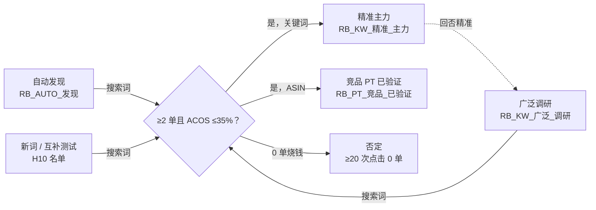

# Case One：Ring Banner 广告结构与 SI 规则设计报告

来源：grok.bot Page [Ring Banner 广告结构与 SI 规则设计报告](https://ring-banner-si-ym6z.pages.grok.bot/)。数据时段为 2026-10-14 至 2026-11-12，经 Get MCP Ads 只读拉取。

> ⚠️ 提醒
>
> 1. 本报告目标 ACOS 按 30% 计算，不是当前目标 45%–50%；出价上下限、目标 CPC（$0.74）等出价数字都需要按 45%–50% 重新核算。
> 2. 报告中“SI 不能建活动/广告组/关键词，结构调整全靠 Bulk Sheet”的说法只对 SI MCP 成立；SI 网页端 Mass Campaigns（FMC 全托管、SKC 拆词建活动、SPC 拆 ASIN 建商品定投、BAC 批量自动）可以建活动，见 https://docs.scaleinsights.com/docs/how-to-transit-to-automation 和 https://docs.scaleinsights.com/docs/august-2024-release-notes 。

把 SI 的参数套到你的 ring banner（B0H6J55GBP）30 天真实数据上：词和 ASIN 怎么分、79 个活动怎么并成 7 个、每类活动挂哪些规则、怎么分阶段上线、哪些要你批。没有改动任何账户。

## 目录

- [结论](#结论)
- [ring banner 30 天现状](#ring-banner-30-天现状)
- [钱花在哪](#钱花在哪)
- [关键词和 ASIN 分类](#关键词和-ASIN-分类)
- [推荐广告结构](#推荐广告结构)
- [79 个旧活动怎么并](#79-个旧活动怎么并)
- [出价的几个关键数字](#出价的几个关键数字)
- [SI 规则组](#SI-规则组)
- [每类活动挂哪些规则](#每类活动挂哪些规则)
- [上线计划](#上线计划)
- [试用期要测的](#试用期要测的)
- [你批什么，什么自动跑](#你批什么，什么自动跑)
- [文档矛盾和缺的数据](#文档矛盾和缺的数据)
- [来源](#来源)

## 结论

> **问题不是词不够，是出价太高、结构太散。** 客单价 $15.12、转化 16.3%，要做到 30% ACOS，每次点击最多只能花 $0.74，现在平均 $1.26。79 个活动里前 10 个花了 92.5% 的钱，另外 66 个 30 天合计只花 $61.93，数据永远攒不够，SI 的规则也没法判断。

- 79 个 ring banner 活动并成 7 个：保留 5 个大的改名，新建 2 个测试，其余 74 个把有用的词搬走后暂停。
- 订婚和求婚是主力（ACOS 35–36%，转化 24–26%）；单身派对和婚礼词 ACOS 126% 和 171%，降到低价测试。
- SI 先开 5 种：出价、位置、黑白名单、否定、收割；预算只当安全阀；分时、启停、唤醒、默认出价不开。
- 出价上限从上一份手册的 $2.50 改成 $1.20：现在知道了客单价，$2.50 太高。
- 建活动、建广告组、加词、暂停旧活动都走 Bulk Sheet，SI 做不了，每批都要你批。

## ring banner 30 天现状

*10 月 14 日 – 11 月 12 日，7 天归因，Get MCP Ads 只读拉取；和 Codex 报告的销售额、订单数一致*

只算投放 B0H6J55GBP 的 79 个活动；账户里另外的活动投的是 cookie cutter、16 岁生日横幅等其它产品，不在本报告里。

| 指标 | 数值 | 说明 |
|---|---|---|
| 广告花费 | $1,148.58 | 约 $38/天 |
| 广告销售额 | $2,252.38 | 149 单 |
| ACOS | 51.0% | 目标 30% |
| 平均 CPC | $1.26 | 915 次点击 |
| 转化率 | 16.3% | 6.1 次点击出 1 单 |
| 客单价 | $15.12 | 每单广告花费 $7.71 |
| 有数据的活动 | 79 | 49 个有花费 |

| 位置 | 花费 | 点击 | 订单 | ACOS | 转化率 | CPC | 30% ACOS 能出的 CPC |
|---|---|---|---|---|---|---|---|
| 搜索顶部 TOS | $310.93 | 236 | 61 | 33.0% | 25.8% | $1.32 | $1.17 |
| 搜索其余 ROS | $762.17 | 596 | 84 | 61.4% | 14.1% | $1.28 | $0.64 |
| 商品页 PP | $68.56 | 56 | 5 | 81.7% | 8.9% | $1.22 | $0.40 |
| 站外 | $6.92 | 27 | 0 | — | 0% | $0.26 | — |

## 钱花在哪

*按搜索词汇总（400 个不同搜索词）*

| 搜索词分层 | 个数 | 花费 | 订单 | 占花费 | 处理 |
|---|---|---|---|---|---|
| 已验证：≥2 单且 ACOS ≤35% | 9 | $83.43 | 28 | 7% | 进精准 / 竞品 PT，写进白名单 |
| 有量偏贵：≥2 单但 ACOS >35% | 8 | $417.41 | 61 | 36% | 进精准 / PT，降价到目标 |
| 只出 1 单 | 60 | $145.61 | 60 | 13% | 留在广泛和自动里，等第 2 单再收割 |
| 0 单，点击 ≥10 | 1 | $19.47 | 0 | 2% | 否定（bachelorette party favors） |
| 0 单，点击 5–9 | 7 | $60.65 | 0 | 5% | 先降价，到 12 次再降，到 20 次停 |
| 0 单，点击 <5 | 315 | $422.01 | 0 | 37% | 单个词否不过来，靠降价和合并活动 |

400 个搜索词里 323 个只有 1 次点击。37% 的钱花在点击不到 5 次的 0 单词上，“20 次点击没单就否定”这类规则抓不到它们，所以重点是把出价降到 $0.74 附近、把流量集中到少数活动里。

| 按意图 | 搜索词数 | 点击 | 花费 | 订单 | ACOS | 转化率 | 定位 |
|---|---|---|---|---|---|---|---|
| 订婚 engagement | 95 | 202 | $246.45 | 49 | 35% | 24.3% | 主力 |
| 戒指元素 ring | 21 | 31 | $38.66 | 7 | 31% | 22.6% | 主力 |
| 求婚 proposal | 10 | 19 | $24.43 | 5 | 36% | 26.3% | 主力（量小） |
| 新娘送礼会 bridal shower | 33 | 43 | $51.68 | 6 | 46% | 14.0% | 次主力 |
| 泛装饰 / 其它 | 26 | 28 | $32.13 | 3 | 77% | 10.7% | 测试 |
| 单身派对 bachelorette | 61 | 86 | $105.37 | 6 | 126% | 7.0% | 低价测试 |
| 婚礼 / 纪念日 | 47 | 65 | $71.93 | 3 | 171% | 4.6% | 低价测试 |

## 关键词和 ASIN 分类

### 实测搜索词

| 类别 | 搜索词 / ASIN | 点击 | 花费 | 订单 | ACOS | 放进 |
|---|---|---|---|---|---|---|
| 已验证 | engagement decorations | 17 | $22.10 | 6 | 23% | 精准主力·订婚 |
| 已验证 | engaged decorations | 8 | $10.40 | 5 | 15% | 精准主力·订婚 |
| 已验证 | engagement banner | 8 | $9.38 | 3 | 23% | 精准主力·订婚 |
| 已验证 | personalized engagement party banners | 3 | $3.90 | 2 | 14% | 精准主力·订婚 |
| 已验证 | celebration engagement、diamond ring banner long 2 fr | 2 | $2.28 | 4 | 4% | 精准主力·戒指 |
| 已验证 | B0CR9V561Q（Lingqiang BRIDE 气球） | 15 | $20.36 | 3 | 24% | 竞品已验证 |
| 已验证 | B0F5Q16JYR | 9 | $12.56 | 3 | 30% | 竞品已验证 |
| 已验证 | B0GBV2TXQ6 | 2 | $2.45 | 2 | 9% | 竞品已验证 |
| 有量偏贵 | B097L1FLW3（LMGERBUD 戒指气球） | 153 | $209.11 | 30 | 50% | 竞品已验证，出价降到 $0.70 |
| 有量偏贵 | B07W8CLRGG（PartyForever） | 56 | $78.11 | 10 | 47% | 竞品已验证 |
| 有量偏贵 | B0B6VKWRTZ | 28 | $37.59 | 5 | 54% | 同类横幅 |
| 有量偏贵 | B07WGLBH2D | 9 | $12.30 | 2 | 44% | 竞品已验证 |
| 有量偏贵 | engagement party decorations | 32 | $36.50 | 7 | 37% | 精准主力·订婚 |
| 有量偏贵 | engagement party decor | 13 | $17.20 | 3 | 41% | 精准主力·订婚 |
| 有量偏贵 | engagement decor | 12 | $15.70 | 2 | 56% | 精准主力·订婚 |
| 有量偏贵 | bridal shower decorations | 8 | $10.90 | 2 | 39% | 精准主力·送礼会 |
| 1 单，留观察 | ring banner、engagement ring banner、she said yes decorations、proposal decorations 等 60 个 | 117 | $145.61 | 60 | 16% | 广泛 / 自动 |
| 该否 | bachelorette party favors | 15 | $19.47 | 0 | — | 精准否定 |

### H10 关键词

| H10 关键词分组 | 个数 | P1 / P2 / P3 | 例子 | 30 天已投过 | 出过单 | 建议放进 |
|---|---|---|---|---|---|---|
| 场景+气球长尾 | 19 | 9 / 10 / 0 | engagement balloons、ring balloon、she said yes balloons | 3 | 0 | 新词测试，$0.50 起（产品是横幅，balloon 词相关性打折） |
| 新场景大词 | 39 | 10 / 18 / 11 | will you marry me decorations、proposal decorations for outdoor、anniversary decorations | 2 | 0 | 求婚类进新词测试；婚礼、纪念日、情人节类低价 |
| 互补品类词 | 41 | 10 / 25 / 6 | engagement banner、will you marry me sign、bride to be sash | 9 | 1 | engagement banner 进精准；横幅、标牌类进新词测试；绶带、头纱类低价 |
| 否定词 | 12 | — | engagement ring、ring pop、ring box、flameless candles | — | — | 黑名单 Negative Exact List |
| 按意图（不含否定词 99 个） | 99 | — | 婚礼/纪念日 31、订婚 19、求婚 17、单身派对 15、泛装饰 11、送礼会 4、戒指 2 | 14 | 1 | 订婚、求婚、戒指先投；婚礼和单身派对实测 ACOS 超过 120%，最后投 |

### H10 ASIN

| H10 ASIN 分组 | 个数 | 已投过 | 出过单 | 例子 | 建议放进 |
|---|---|---|---|---|---|
| 直接竞品 | 6 | 5 | 2 | B097L1FLW3 LMGERBUD、B07W8CLRGG PartyForever、B09NVRQ89C、B0FN7ZVS2K | 竞品已验证（出单的）/ 互补测试（没出单的） |
| 弱竞品（评论少或评分低） | 14 | 1 | 0 | B0FN82TZHV PartyForever、B0H1HKY8B6 Vsdski | 互补测试，出价 $0.50 |
| 防守·戒指套装 | 4 | 1 | 0 | B0G514V96T Paeyeq、B0FL25GX3Z FunHot | 互补测试 |
| 互补品定投 | 24 | 7 | 2 | B0F48KS4Q2 Papoopy 头纱、B0CR9V561Q BRIDE 气球、B098LTBZ8F 蛋糕插牌 | 互补测试；B0CR9V561Q 进已验证 |
| H10 名单外、自动广告跑出单的 | 18 | 18 | 18 | B0B6VKWRTZ、B0F5Q16JYR、B07WGLBH2D、B0GBV2TXQ6 | ≥2 单的进已验证，1 单的留在自动 |

H10 名单是 11 月 12 日按戒指气球竞品做的，你的产品是横幅，所以含 balloon 的 29 个词相关性要打折扣：实测里 balloons 这个词 12 次点击 1 单，ACOS 106%。深度 ASIN 表另有 1,729 个（互补品 1,134、同场景套装 429、不相关 121、直接竞品 23、弱竞品 22），先不投，按上表 48 个起步。

## 推荐广告结构

*命名：RB_类型_匹配_用途；一个广告组只放一个主题；预算按现在约 $38/天分*

| 活动 | 用途 | 广告组 | 预算占比 · 每天 | 出价上限 | 来源 |
|---|---|---|---|---|---|
| RB_KW_精准_主力 | 已验证词，精准 | 订婚、求婚+戒指、送礼会，各 1 组 | 30% · $11.5 | $1.20 | 保留：L0 KW 自动广告 搜索词 cpa<6 EXACT |
| RB_PT_竞品_已验证 | 出过单的竞品 ASIN | 戒指气球竞品、已验证其它 ASIN | 22% · $8.5 | $1.00 | 保留：L2 ASIN 主题 dimond ring - ring balloons |
| RB_PT_同类横幅 | 同类横幅 ASIN | bride to be / engagement banner | 10% · $4 | $1.00 | 保留：L1 ASIN同类 bride to be banner |
| RB_KW_广泛_调研 | 找新词，广泛 | 订婚、求婚、送礼会、戒指、单身派对（低价） | 15% · $5.5 | $0.90 | 保留：L0 KW 天生就能… BROAD |
| RB_AUTO_发现 | 自动四组 | 紧密、宽泛、同类、关联 | 13% · $5 | $0.80 | 保留：L0 ring banner AUTO 紧密 宽泛 |
| RB_PT_互补_测试 | 互补品 ASIN、类目 | 头纱/绶带、蛋糕插牌、类目 | 5% · $2 | $0.70 | 新建 |
| RB_KW_新词_测试 | H10 没测过的词，词组 | 按意图各 1 组 | 5% · $2 | $0.70 | 新建 |

品牌防守活动暂不建：30 天搜索词里没有任何品牌词，品牌名也不在我手上；你告诉我品牌名后可以加 1 个 $2/天的品牌词精准活动。

## 79 个旧活动怎么并

*30 天花费和订单；“并入后暂停”指先把出过单或在主题名单里的词搬到新位置，再暂停原活动*

| 去向 | 旧活动数 | 30 天花费 | 订单 | ACOS |
|---|---|---|---|---|
| RB_PT_竞品_已验证 | 4 | $306.92 | 40 | 51.0% |
| RB_AUTO_发现 | 3 | $289.31 | 37 | 52.3% |
| RB_KW_广泛_调研 | 11 | $283.62 | 38 | 50.9% |
| RB_PT_同类横幅 | 2 | $174.92 | 19 | 52.1% |
| RB_KW_精准_主力 | 3 | $43.28 | 11 | 29.3% |
| RB_PT_互补_测试（新建） | 40 | $40.02 | 5 | 57.2% |
| 直接暂停（不相关：ring pops、pool float、taylor swift 等） | 16 | $10.51 | 0 | — |

下方列出全部 79 个旧活动（对应页面里「保留改名 5 / 并入后暂停 58 / 直接暂停 16 / 全部 79」的完整视图）。

| 旧活动 | 去向 | 动作 | 30 天花费 | 订单 | ACOS |
|---|---|---|---|---|---|
| L2 ASIN 主题 dimond ring - ring balloons | RB_PT_竞品_已验证 | 保留改名 | $286.22 | 37 | 52% |
| L1 ASIN同类 bride to be banner | RB_PT_同类横幅 | 保留改名 | $169.72 | 19 | 51% |
| L0 KW 天生就能把CPA跑到5.5以下 BROAD - 来自测试 kw targeting | RB_KW_广泛_调研 | 保留改名 | $163.89 | 25 | 45% |
| L0 ring banner AUTO 紧密 宽泛 | RB_AUTO_发现 | 保留改名 | $145.26 | 19 | 50% |
| L0 AUTO 同类ASIN 关联ASIN | RB_AUTO_发现 | 并入后暂停 | $128.19 | 14 | 62% |
| L1 KW主力 - bridal shower decorations | RB_KW_广泛_调研 | 并入后暂停（送礼会组） | $59.65 | 7 | 53% |
| L0 KW 自动广告 搜索词 cpa<6 EXACT | RB_KW_精准_主力 | 保留改名 | $40.28 | 10 | 30% |
| L1 KW主力 - engagement party decorations | RB_KW_广泛_调研 | 并入后暂停（订婚组） | $37.22 | 5 | 53% |
| AUTO V2 ring banner | RB_AUTO_发现 | 并入后暂停 | $15.86 | 4 | 28% |
| L0 ASIN 低CPA组 - 天生就能把CPA跑到5.5以下 | RB_PT_竞品_已验证 | 并入后暂停 | $15.70 | 3 | 28% |
| L3 关联ASIN bach engaged 拍照相关 | RB_PT_互补_测试 | 并入后暂停 | $10.37 | 2 | 37% |
| L2 KW ring balloons | RB_KW_广泛_调研 | 并入后暂停（戒指组） | $9.09 | 1 | 65% |
| * L1 ASIN同类 bride to be banner 2 | RB_PT_同类横幅 | 并入后暂停 | $5.20 | 0 | — |
| ring banner V2.1 ASIN PROVEN | RB_PT_竞品_已验证 | 并入后暂停 | $3.00 | 0 | — |
| ring banner v2.1 kw proven | RB_KW_精准_主力 | 并入后暂停 | $3.00 | 1 | 25% |
| L1 KW proposal | RB_KW_广泛_调研 | 并入后暂停 | $3.00 | 0 | — |
| L1 KW主力 - bachelorette party decorations | RB_KW_广泛_调研 | 并入后暂停 | $3.00 | 0 | — |
| L4 ASIN关联 engagement gift | RB_PT_互补_测试 | 并入后暂停 | $3.00 | 1 | 21% |
| L5 ASIN关联 弱相关 just married | RB_PT_互补_测试 | 并入后暂停 | $3.00 | 1 | 21% |
| L3 KW gold party decoration | RB_KW_广泛_调研 | 并入后暂停 | $2.96 | 0 | — |
| * L2 ASIN 主题 dimond ring - ring balloons 2 | RB_PT_互补_测试 | 并入后暂停 | $2.74 | 0 | — |
| L4 ASIN同类 bridal shower backdrop | RB_PT_互补_测试 | 并入后暂停 | $2.67 | 1 | 19% |
| L5 ASIN关联 不相关 bride tote bag | — | 直接暂停（不相关） | $2.56 | 0 | — |
| ASIN V2 ring banner PROVEN | RB_PT_竞品_已验证 | 并入后暂停 | $2.00 | 0 | — |
| L3 ASIN - in my engaged era | RB_PT_互补_测试 | 并入后暂停 | $2.00 | 0 | — |
| L1 KW wedding | RB_KW_广泛_调研 | 并入后暂停 | $2.00 | 0 | — |
| L1 ASIN同类 she said yes decorations | RB_PT_互补_测试 | 并入后暂停 | $2.00 | 0 | — |
| L4 ASIN关联 bachelorette veil | RB_PT_互补_测试 | 并入后暂停 | $2.00 | 0 | — |
| L5 ASIN关联 弱相关 cowgirl party decorations | — | 直接暂停（不相关） | $2.00 | 0 | — |
| L1 KW主力 - bride to be banner | RB_KW_广泛_调研 | 并入后暂停 | $1.81 | 0 | — |
| L4 ASIN关联 弱相关 wedding | RB_PT_互补_测试 | 并入后暂停 | $1.34 | 0 | — |
| L2 ASIN 主题 diamond ring - pool float | — | 直接暂停（不相关） | $1.00 | 0 | — |
| L2 KW led ring | — | 直接暂停（不相关） | $1.00 | 0 | — |
| L5 ASIN - wedding favor | RB_PT_互补_测试 | 并入后暂停 | $1.00 | 0 | — |
| L1 KW bride | RB_KW_广泛_调研 | 并入后暂停 | $1.00 | 0 | — |
| L3 ASIN my humans are getting married dog bandana | — | 直接暂停（不相关） | $1.00 | 0 | — |
| L1 ASIN同类 bachelorette party decorations | RB_PT_互补_测试 | 并入后暂停 | $1.00 | 0 | — |
| L1 ASIN同类 engagement party decorations | RB_PT_互补_测试 | 并入后暂停 | $1.00 | 0 | — |
| L1 ASIN关联 bridal shower balloons | RB_PT_互补_测试 | 并入后暂停 | $1.00 | 0 | — |
| L5 ASIN关联 bride to be sash | RB_PT_互补_测试 | 并入后暂停 | $1.00 | 0 | — |
| L4 ASIN关联 bridal shower photo booth props | RB_PT_互补_测试 | 并入后暂停 | $1.00 | 0 | — |
| L5 ASIN相关 弱相关 barbie party decorations | — | 直接暂停（不相关） | $1.00 | 0 | — |
| L5 ASIN关联 低相关 wedding gifts | RB_PT_互补_测试 | 并入后暂停 | $1.00 | 0 | — |
| L5 ASIN关联 弱关联 denim and diamonds party decorations | — | 直接暂停（不相关） | $1.00 | 0 | — |
| L5 ASIN关联 中相关 just engaged | RB_PT_互补_测试 | 并入后暂停 | $1.00 | 0 | — |
| L4 ASIN关联 弱相关 wedding favors | RB_PT_互补_测试 | 并入后暂停 | $1.00 | 0 | — |
| L5 ASIN关联 弱相关 bride box | RB_PT_互补_测试 | 并入后暂停 | $1.00 | 0 | — |
| L5 ASIN关联 不相关 taylor swift party decorations | — | 直接暂停（不相关） | $0.95 | 0 | — |
| CT 本品类目 | RB_PT_互补_测试 | 并入后暂停（类目组） | $0.90 | 0 | — |
| L0 KW v2 ring banner PROVEN | RB_KW_精准_主力 | 并入后暂停 | $0.00 | 0 | — |
| L2 ASIN 主题 diamond ring - ring lolipops | — | 直接暂停（不相关） | $0.00 | 0 | — |
| L2 ASIN 主题 diamond ring - bridal shower diamond ring decor | RB_PT_互补_测试 | 并入后暂停 | $0.00 | 0 | — |
| L2 主题 diamond ring - 所有 DIAMOND RING 合集 | RB_PT_互补_测试 | 并入后暂停 | $0.00 | 0 | — |
| L2 ASIN 主题 diamond ring - led diamond ring | — | 直接暂停（不相关） | $0.00 | 0 | — |
| L2 KW ring pops | — | 直接暂停（不相关） | $0.00 | 0 | — |
| L2 KW ring floats | — | 直接暂停（不相关） | $0.00 | 0 | — |
| L3 ASIN engagment candle | RB_PT_互补_测试 | 并入后暂停 | $0.00 | 0 | — |
| L3 ASIN - ring holer | — | 直接暂停（不相关） | $0.00 | 0 | — |
| L3 ASIN gold party decoration | RB_PT_互补_测试 | 并入后暂停 | $0.00 | 0 | — |
| L3 ASIN engagment card | RB_PT_互补_测试 | 并入后暂停 | $0.00 | 0 | — |
| L0 CT | RB_PT_互补_测试 | 并入后暂停（类目组） | $0.00 | 0 | — |
| L1 ASIN同类 bridal shower sign | RB_PT_互补_测试 | 并入后暂停 | $0.00 | 0 | — |
| L4 ASIN关联 girls night games | RB_PT_互补_测试 | 并入后暂停 | $0.00 | 0 | — |
| L5 ASIN关联 bachelorette party games | RB_PT_互补_测试 | 并入后暂停 | $0.00 | 0 | — |
| L5 ASIN关联 proposal decorations | RB_PT_互补_测试 | 并入后暂停 | $0.00 | 0 | — |
| L1 KW主力 - bridal shower backdrop | RB_KW_广泛_调研 | 并入后暂停 | $0.00 | 0 | — |
| L1 ASIN同类 bridal shower decorations | RB_PT_互补_测试 | 并入后暂停 | $0.00 | 0 | — |
| L5 ASIN关联 bride balloons | RB_PT_互补_测试 | 并入后暂停 | $0.00 | 0 | — |
| L4 ASIN关联 bachelorette sashes | RB_PT_互补_测试 | 并入后暂停 | $0.00 | 0 | — |
| L5 ASIN关联 弱相关 camp bachelorette | RB_PT_互补_测试 | 并入后暂停 | $0.00 | 0 | — |
| L4 ASIN关联 中相关 bachlorette games | RB_PT_互补_测试 | 并入后暂停 | $0.00 | 0 | — |
| L5 ASIN关联 不相关 taylor swift balloons | — | 直接暂停（不相关） | $0.00 | 0 | — |
| L5 ASIN关联 不相关 bride makeup bag | — | 直接暂停（不相关） | $0.00 | 0 | — |
| L5 ASIN关联 中相关 proposal ideas | RB_PT_互补_测试 | 并入后暂停 | $0.00 | 0 | — |
| L5 ASIN关联 弱相关 bridal shower cake topper | RB_PT_互补_测试 | 并入后暂停 | $0.00 | 0 | — |
| L4 ASIN关联 中相关 girls night games | RB_PT_互补_测试 | 并入后暂停 | $0.00 | 0 | — |
| L5 ASIN关联 中相关 bachelorette party games | RB_PT_互补_测试 | 并入后暂停 | $0.00 | 0 | — |
| L5 ASIN关联 不相关 bride slippers | — | 直接暂停（不相关） | $0.00 | 0 | — |
| L5 ASIN关联 中相关 bride accessories | RB_PT_互补_测试 | 并入后暂停 | $0.00 | 0 | — |

为什么保留 5 个而不是全部重建：SI 按广告组的历史数据算出价，重建会丢掉这 5 个活动 30 天里 110 单的历史。

## 出价的几个关键数字

$$
\text{目标 CPC} = \text{客单价} \times \text{目标 ACOS} \times \text{转化率} = \$15.12 \times 30\% \times 16.3\% = \$0.74
$$

$$
\text{点击 20 次 0 单的概率} = (1 - 16.3\%)^{20} \approx 2.9\%
$$

用纯文本写就是：目标 CPC = 客单价 × 目标 ACOS × 转化率 = $15.12 × 30% × 16.3% = $0.74；点击 20 次 0 单的概率 = (1 − 16.3%)²⁰ ≈ 2.9%。

| 项目 | 说明 |
|---|---|
| 目标每单花费 | $4.54（$15.12 × 30%），现在是 $7.71 |
| 每单要几次点击 | 6.1 次（915 ÷ 149） |
| 12 次点击 0 单 | 正常词出现的概率约 12%，花费约 $8.9，是目标每单花费的 2 倍，所以先降价不停 |
| 20 次点击 0 单 | 概率约 2.9%，花费约 $14.8，基本可以认定是坏词，所以停或否定 |
| TOS 出价空间 | TOS 转化 25.8%，能出 $1.17；ROS 只能出 $0.64，PP 只能出 $0.40 |
| 推导出的做法 | 基础出价压到 $0.65 左右，TOS 加价 50–80% 把顶部拉到约 $1.10，ROS 和 PP 不加价 |

30% 是你定的目标。你的产品成本和利润率我没有，所以算不出保本 ACOS；在 SI 里填上产品成本后可以再核对一次目标。

## SI 规则组

*“如果…就…”写法；参数用 SI 文档原名，名称未核实的已在上一份手册标出*

以下按页面里的 7 组规则全部列出（出价、位置、否定、否定单词、黑白名单、收割、预算）。

### 出价

出价：主力。三条规则按顺序：先停、再降、再按目标算价。

| 规则 | 如果 | 就 | 参数值 | 挂在 |
|---|---|---|---|---|
| B1 停坏词 | 点击 ≥20 且订单 = 0（关键词）；点击 ≥15 且订单 = 0（ASIN 投放） | 暂停这个词或这个 ASIN 投放 | Action = Pause；Days to Analyze 90；Days of Recent Data to Ignore 2；优先级最高 | 除精准主力外全部 |
| B2 先降价 | 点击 ≥12 且订单 = 0 | 出价降 20% | Action = Percentage −20%；Days 60 / 2；优先级第二 | 全部 |
| B3 按目标算价 | 点击 ≥8 | 按 30% ACOS 算出最优出价，每次最多改 10% | Action = Target ACOS；Target ACOS 30%；Optimize bid using Keyword Revenue Per Click 开；每次最大加价 / 降价 10%；Days 60 / 2 | 全部 |
| B3 出价上下限 | — | 出价不低于下限、不高于上限 | Min Bid $0.25；Max Bid：精准主力 $1.20、竞品 PT $1.00、广泛 $0.90、自动 $0.80、测试 $0.70 | 按活动类型 |
| B3 扣掉加价 | 活动有 TOS 加价时 | 算价时扣掉位置加价和动态竞价抬高的部分 | Normalize: Placement modifier 开（选 TOS）；Normalize: Dynamic Up & Down 只在用“提高和降低”策略时开 | 全部 |

### 位置

位置：你的数据最需要这个：TOS 转化 25.8%，商品页只有 8.9%。

| 规则 | 如果 | 就 | 参数值 | 挂在 |
|---|---|---|---|---|
| P1 TOS 慢慢加 | 近 60 天 TOS ACOS ≤30% 且 TOS 订单 ≥3 | TOS 加价 +10%，加到上限为止 | Placement = TOS；Increment Value 10%；Placement % Value：精准主力 100%、其它 50%；Days to Observe 7（This Rule's Placement Only） | 精准主力、广泛调研、竞品 PT |
| P2 TOS 兜底 | TOS ACOS ≥45% 且 TOS 点击 ≥15 | TOS 加价 −20%，最低到 0% | Decrement Value 20%；Placement % Value 0%；Days to Observe 7 | 所有挂了 P1 的活动 |
| P3 ROS / PP 归零 | ROS 或 PP 的 ACOS ≥45% 且点击 ≥15 | 该位置加价降到 0% | Placement = ROS / PP；Decrement Value 10%；Placement % Value 0% | 全部 |
| 竞价策略（不是 SI 规则） | — | 统一改成“只降低” | Bulk Sheet 或 MCP 改 bid strategy = Dynamic bids – down only | 全部 |

### 否定

否定：开，但按现在的数据 30 天只会抓到 1 个词，真正省钱靠降价和合并。

| 规则 | 如果 | 就 | 参数值 | 挂在 |
|---|---|---|---|---|
| N1 关键词搜索词 | 点击 ≥20 且订单 = 0（90 天） | 加精准否定 | Search Terms Source = ASIN Search Terms；Negative Exact；Apply negatives at = Ad Group；Days 90 / 2 | 自动、广泛调研、新词测试 |
| N2 ASIN 搜索词 | 点击 ≥12 且订单 = 0（90 天） | 加否定商品 | 同上，类型为否定商品 | 自动、互补测试 |
| N3 回否（漏斗） | 搜索词已经收割进精准主力 | 在来源广告组加精准否定，避免自己抢自己 | SI 文档没写收割会自动回否；试用时验证，不行就用 Bulk Sheet 每周补 | 自动、广泛调研 |

### 否定单词

否定单词：白名单设好后第 3 周再开。

| 规则 | 如果 | 就 | 参数值 | 挂在 |
|---|---|---|---|---|
| W1 差单词 | 单词合并后点击 ≥30 且订单 = 0（90 天） | 加词组否定 | Criteria 点击 ≥30、订单 = 0；Days 90 / 2 | 自动、广泛调研（不挂精准） |
| 参考 | 现在 0 单的单词里点击最多的是 christmas 7 次、accessories 6 次 | 暂时没有词会被触发 | — | — |

### 黑白名单

黑白名单：第 1 天就设，挡住误否和明显不相关的流量。

| 规则 | 如果 | 就 | 参数值 | 挂在 |
|---|---|---|---|---|
| Phrase Whitelist | — | 这些词不会被否定单词误伤 | engagement、engaged、proposal、she said yes、marry me、ring banner、diamond ring banner | 整个产品 |
| Exact Whitelist | — | 已出单的好词不被否定 | engagement decorations、engaged decorations、engagement banner、engagement party decorations、engagement party decor、engagement decor、bridal shower decorations、personalized engagement party banners | 整个产品 |
| Negative Exact List | — | 首饰、糖果、蜡烛、酒杯类流量直接屏蔽 | H10 否定词 12 个：engagement rings for women、engagement ring、wedding ring、diamond ring、rose gold ring、promise rings、fake engagement ring、ring pop、ring box、flameless candles、led candles、champagne flutes | 整个产品 |

### 收割

收割：第 2 周开，目的地是精准主力和竞品 PT。

| 规则 | 如果 | 就 | 参数值 | 挂在 |
|---|---|---|---|---|
| I1 关键词收割 | 订单 ≥2 且 ACOS ≤35%（90 天） | 加成精准词，放进精准主力对应主题组 | Search Term Source = Sponsored Products；Match Type = Exact；Initial bid = 平均 CPC 的 70%；Max keywords 30 | 来源：自动、广泛调研、新词测试 |
| I2 ASIN 收割 | 订单 ≥2 且 ACOS ≤35% | 加成 ASIN 投放，放进竞品已验证 | Match Type = 商品投放；其余同上 | 来源：自动、互补测试 |
| 现在就满足条件的 | — | 6 个词 + 3 个 ASIN，第 0 天直接用 Bulk Sheet 放进去 | 见“分类”一节的已验证表 | — |

### 预算

预算：只当安全阀，不靠它调结构。

| 规则 | 如果 | 就 | 参数值 | 挂在 |
|---|---|---|---|---|
| U1 好活动加钱 | ACOS ≤25% 且订单 ≥5（30 天） | 预算 +20% | Daily Budget Baseline = 当前预算；Max Budget = 当前 2 倍；Days to observe change 7 | 全部 |
| U2 差活动减钱 | ACOS ≥50% 且花费 ≥$30（30 天） | 预算 −20% | Min Budget = 当前一半 | 全部 |

## 每类活动挂哪些规则

| 活动 | 出价 B1/B2/B3 | 位置 | 否定 | 否定单词 | 收割 | 预算安全阀 |
|---|---|---|---|---|---|---|
| RB_KW_精准_主力 | B2、B3（不挂 B1，好词只降不停） | P1 到 100%、P2、P3 | 不挂 | 不挂 | 收割目的地 | U1、U2 |
| RB_PT_竞品_已验证 | B1、B2、B3 | P1 到 50%、P2、P3 | 不挂 | 不挂 | ASIN 收割目的地 | U1、U2 |
| RB_PT_同类横幅 | B1、B2、B3 | P1 到 50%、P2、P3 | 不挂 | 不挂 | — | U1、U2 |
| RB_KW_广泛_调研 | B1、B2、B3 | P1 到 50%、P2、P3 | N1、N3 | W1（第 3 周） | 收割来源 | U2 |
| RB_AUTO_发现 | B1、B2、B3（按四个投放组） | P3 | N1、N2、N3 | W1（第 3 周） | 收割来源 | U2 |
| RB_PT_互补_测试 | B1、B2、B3，上限 $0.70 | P3 | N2 | 不挂 | 收割来源 | 不挂 |
| RB_KW_新词_测试 | B1、B2、B3，上限 $0.70 | P3 | N1 | W1（第 3 周） | 收割来源 | 不挂 |

黑白名单按产品生效，7 个活动都受保护；分时、启停、唤醒、默认出价 4 种不开。

## 上线计划

1. **第 0 天：你批 Bulk Sheet 第 1 批**
   5 个活动改名；新建 2 个测试活动和精准主力的 3 个主题组；放进已验证的 6 个词、3 个 ASIN，偏贵的 8 个以 $0.65 起；加 12 个精准否定；竞价策略改成“只降低”。可用免费的 SP Bulk Sheet Builder 核对格式。
2. **第 1–7 天：开 SI 试用，只托管 B0H6J55GBP**
   先建黑白名单；出价 B1–B3 和位置 P1–P3 先用 Preview / Strategy Simulator 看改动，你确认后再打开；否定 N1、N2 一起开。
3. **第 8–14 天：你批 Bulk Sheet 第 2 批**
   新活动拿到曝光后，暂停 74 个旧活动（16 个不相关的可以第 0 天就停）；打开收割 I1、I2，验证会不会自动回否。
4. **第 15–21 天：开否定单词和预算安全阀**
   白名单确认没被误伤后打开 W1；预算 U1、U2 打开。
5. **第 22–30 天：对账，决定买不买**
   我建议的达标线：ACOS ≤40%、CPC ≤$0.95、30 天订单不低于 130。达标再考虑 Scale 5（$78/月）。

预算总额不变，约 $38/天，按“推荐广告结构”表分配。账户里其它产品的活动不受影响，继续按现在的方式管。

## 试用期要测的

| 要测的 | 怎么测 | 为什么 |
|---|---|---|
| 优先级数字谁大谁先 | 在测试广告组挂两条冲突规则，看 Preview 执行哪条 | 文档两处说法相反，B1 必须先于 B3 |
| 出价算出来是否在 $0.74 附近 | B3 用 Strategy Simulator 跑 60 天 | 确认 Revenue Per Click 和 Normalize 按预期扣减 |
| MCP 能否改出价并撤销 | propose → apply → undo 改 1 个词 | 以后每周改动都要能撤回 |
| MCP 能否暂停 SP 活动 | 对 1 个已停用的旧活动试 | 发布说明说能，FAQ 说不能 |
| 规则包怎么应用 | 只预览，不应用 | 规则包应用后撤不回，文档写了上传 ZIP 和对话里应用两种 |
| 收割会不会自动回否 | I1 跑一周后查来源组否定词 | 不会的话 N3 改用每周 Bulk Sheet |
| 白名单能否挡住否定单词 | W1 开启后看变更日志 | 防止 engagement 这种核心词被误否 |
| 变更日志好不好读 | 每周导出一次 | 你不想自己解读，我要能把它变成一页周报 |

## 你批什么，什么自动跑

| 事项 | 谁做 | 你要做的 |
|---|---|---|
| 建活动、广告组、加词、加 ASIN、暂停旧活动 | Bulk Sheet | 每批批一次 |
| 第一次打开每种规则、改目标 ACOS 或出价上限 | SI | 批一次 |
| 应用规则包 | SI | 批一次（撤不回） |
| 改黑白名单 | SI | 批一次 |
| 每天按规则调出价（上下限内，每次 ≤10%） | SI 自动 | 不用管 |
| 位置加价每次 ±10–20% | SI 自动 | 不用管 |
| 否定满足条件的词、收割好词（每组 ≤30 个） | SI 自动 | 不用管 |
| 预算在上下限内 ±20% | SI 自动 | 不用管 |
| 每周一页周报：SI 改了什么、ACOS 变化、要你批的下一批 | 我 | 看结论，回“批”或“不批” |

## 文档矛盾和缺的数据

| 问题 | 影响 | 处理 |
|---|---|---|
| 规则优先级方向，文档说法相反 | B1 停词和 B3 算价可能顺序颠倒 | 试用第 1 天先测 |
| SP 活动暂停：发布说明说能，FAQ 说不能 | 暂停旧活动可能要走 Bulk Sheet | 默认走 Bulk Sheet |
| SI 不能建活动、广告组、关键词 | 结构调整全靠 Bulk Sheet | 已按此设计 |
| Initial bid、每次最大加降价的字段原名未核实 | 配置时字段名可能不同 | 试用时对照界面 |
| Codex 报告文件在我这边打不开 | 没逐条对照它的建议 | 我重新拉了同一时段数据，销售额和订单数一致 |
| 品牌名、产品成本 / 利润率 | 建不了品牌防守，算不出保本 ACOS | 需要你提供 |
| H10 关键词 99 个里有 85 个没投过 | 它们的表现是未知数 | 放进新词测试，低价跑 |

## 来源

| 标题 | 出处 |
|---|---|
| [Scale Insights 11 种自动化算法参数手册](https://cursor.com/canvas/store-491e490e-73a3-4e15-bdf7-3017f3453adf/456d44d3-29ba-48cb-be37-1aa82ef1bc8f) | 你的 Page |
| [Scale Insights MCP 能力调查报告](https://cursor.com/canvas/store-491e490e-73a3-4e15-bdf7-3017f3453adf/d16d2f2b-40ac-4f92-816a-a3da5ab3a46a) | 你的 Page |
| [What is the Bidding Rule?](https://docs.scaleinsights.com/docs/what-is-the-bidding-rule) | SI 文档 |
| [What is the Placement Rule?](https://docs.scaleinsights.com/docs/what-is-the-placement-rule) | SI 文档 |
| [What is the Import Rule?](https://docs.scaleinsights.com/docs/what-is-the-import-rule) | SI 文档 |
| [What is the Negative Rule?](https://docs.scaleinsights.com/docs/what-is-the-negative-rule) | SI 文档 |
| [What is the Blacklist/Whitelist Rule?](https://docs.scaleinsights.com/docs/what-is-the-blacklist-whitelist-rule) | SI 文档 |
| [SP Bulk Sheet Builder（免费）](https://digitalmarketingsupport.org/amazon-bulksheet-builder/) | digitalmarketingsupport.org |
