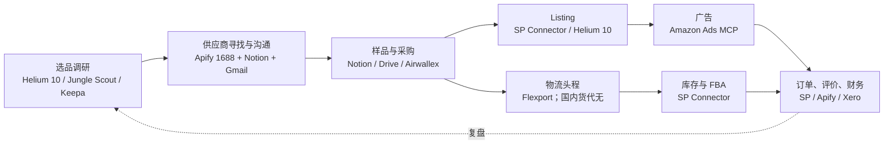

# 亚马逊自动化流程与可接入 MCP 地图

> AutoSell 全链路 10 个环节各能接哪些 MCP，重点是 1688 供应商环节怎么自动化，以及先接哪几个。链接都在 2026 年 11 月 11 日打开核实过。

## 目录

- [流程总览](#流程总览)
- [各环节可接入的 MCP](#各环节可接入的-mcp)
- [供应商环节自动化设计](#供应商环节自动化设计)
- [已连接与内置能力](#已连接与内置能力)
- [建议优先接入](#建议优先接入)
- [没有现成 MCP 的地方](#没有现成-mcp-的地方)
- [来源](#来源)

## 流程总览

| 环节 | 首选 MCP | 现成程度 |
|---|---|---|
| 选品调研 | Helium 10 或 Jungle Scout、Keepa（均为官方） | 🟢 成熟 |
| 供应商寻找 | Apify MCP + 1688 Actor（只读抓取） | 🟡 可用，只能读 |
| 供应商沟通 | Gmail（已连接）；旺旺无；微信只有社区方案 | 🔴 缺口大 |
| 样品与采购跟踪 | Notion（已连接）+ Google Drive（已连接） | 🟢 成熟 |
| Listing | Amazon Selling Partner Connector（官方 Beta） | 🟢 可用 |
| 广告 | Amazon Ads MCP（官方公测） | 🟡 可用，有门槛 |
| 库存与 FBA | SP Connector；社区 amazon-sp-mcp | 🟢 可用 |
| 订单与客服 | SP Connector 查订单；买家消息没查到 | 🟡 部分 |
| 评价监控 | Apify 评论抓取 + Keepa | 🟢 可用 |
| 财务 | Helium 10 Profits；Xero / QuickBooks | 🟢 可用 |
| 物流头程 | Flexport / Freight Right；国内货代无 | 🟡 部分 |

## 各环节可接入的 MCP

「本平台可装」指在本助手的插件目录里能直接安装；「未上架」的需按其文档自定义接入。星数和推送日期是 2026-11-11 在 GitHub 上看到的。

### 1. 选品调研（6）

| 名称 | 类型与维护 | 能做什么 | 限制与风险 |
|---|---|---|---|
| [Helium 10 MCP](https://github.com/helium10/Helium10-MCP) | 官方 · 托管 · 本平台未上架 | 反查 ASIN 关键词、Black Box 选品、ABA 搜索词、Listing 分析、利润/库存/广告数据，约 169 个工具 | 需 Diamond 及以上套餐，每月含 1000 次调用；OAuth 登录 |
| [Jungle Scout MCP](https://www.junglescout.com/products/jungle-scout-mcp/) | 官方 · 托管 · 本平台未上架 | 按 ASIN/关键词查关键词、历史搜索量、产品库筛选、ASIN 销量估算、关键词品牌份额（6 个工具） | 需 Cobalt 订阅或单独购买，走销售报价 |
| [Keepa MCP](https://keepa.com/api-docs/mcp.html) | 官方 · 托管 · 本平台未上架 | 价格历史、BSR 排名历史、卖家、Deals、产品查询（端点 `https://keepa.com/mcp`） | 需 Keepa API 订阅或 Pro；调用消耗 API token |
| [cosjef/keepa_MCP](https://github.com/cosjef/keepa_MCP) | 社区 · 67★ · 最近推送 2026-02 | Keepa 产品查询、批量 ASIN、品类分析、销量速度、库存风险 | 非官方；自己部署，需 Keepa API key |
| [Apify MCP + Amazon Reviews Scraper](https://apify.com/junglee/amazon-reviews-scraper) | Apify 官方 MCP · Actor 第三方 · 本平台可装 | 抓竞品评论做痛点/差评分析，也可抓 Amazon 搜索结果 | 按量付费；抓取受亚马逊反爬影响 |
| [Bright Data / Firecrawl](https://github.com/brightdata/brightdata-mcp) | 官方 · 本平台可装 | 通用网页抓取与搜索，适合抓竞品站外信息 | Firecrawl 在本平台只有 skill（CLI），没有 connector；均按量付费 |

### 2. 供应商寻找与沟通（9）

| 名称 | 类型与维护 | 能做什么 | 限制与风险 |
|---|---|---|---|
| [Apify MCP + blueskyscraper/1688-scraper](https://apify.com/blueskyscraper/1688-scraper) | Apify 官方 MCP · Actor 社区 · 本平台可装 Apify | 1688 关键词搜索（中英文）、以图搜货、商品详情（阶梯价、MOQ、SKU、规格、重量）、供应商列表（工厂类型、省份、年限、复购率、验厂） | 按量付费，约 $1/千条商品；11 月 14 日起完整商品页涨到 $9/千条；免登录、只读，不能发消息 |
| [zen-studio-labs/alibaba-1688-mcp](https://github.com/zen-studio-labs/alibaba-1688-mcp) | 社区 · 0★ · 最近推送 2026-11-03 | 托管只读：1688 和阿里巴巴国际站找工厂、比价、MOQ、供应商评分和评价 | 本质是 Apify 上 zen-studio 的 Actor 打包，需要 Apify 账号；很新，用户少 |
| [xiayumu034-crypto/1688-Scraper-MCP](https://github.com/xiayumu034-crypto/1688-Scraper-MCP) | 社区 · 12★ · 最近推送 2026-03 | 本地抓取 1688 搜索、阶梯价、精华评价、供应商履约指标（响应、发货、回头率） | 本地 Chromium 驱动，遇滑块需手动验证或扫码登录，账号有风控风险；需自建部署 |
| [1688 开放平台 API / 1688 Skill Hub](https://open.1688.com/doc/openIndex.htm) | 官方 · 不是 MCP | 开放平台有采购相关 API（询价单、报价、比价）；Skill Hub 提供选品找商、采购询价等 Agent 技能 | 没找到 1688 官方 MCP；API 要申请应用权限 |
| [阿里巴巴国际站 Alibaba Sourcing MCP](https://glama.ai/mcp/servers/Ghazalawy/alibaba-mcp) | 社区 · 只收录在 Glama | 称支持国际站搜索、找供应商、发 RFQ、收报价打分、供应商对比 | Glama 页面写着暂无可部署版本，GitHub 源仓库已打不开；不建议用 |
| [bkmashiro/weixin-mcp](https://github.com/bkmashiro/weixin-mcp) | 社区 · 18★ · 最近推送 2026-10-08 | 通过微信 ClawBot 机器人接口收发文本、图片、文件，查看联系人 | README 写明用的是 ClawBot 机器人，不是个人号；供应商要和机器人对话，真实可用性待测 |
| [企业微信 MCP（wecom-mcp / wecom-mcp-server）](https://github.com/atttx123/wecom-mcp-server) | 社区 · 0–1★ · 2026-04 / 2026-11 | 企业微信消息、联系人、文档、日程 | 只在供应商加了你企业微信时才有用；星少，需自建 |
| [Gmail（已连接）](https://cursor.com/grok-bot/link/v1/marketplace?tab=plugins) | 官方 · 已连接 | 联系国际站/海外供应商，收报价、整理附件 | 每封发出的邮件都要你确认 |
| [Twilio](https://github.com/twilio-labs/mcp) | 官方 · 本平台可装 | 短信/语音 API | 主要是开发向工具；打国内供应商电话用内置拨号更直接 |

### 3. 样品与采购跟踪（4）

| 名称 | 类型与维护 | 能做什么 | 限制与风险 |
|---|---|---|---|
| [Notion（已连接）](https://github.com/makenotion/notion-mcp-server) | 官方 · 已连接 | 样品台账、采购单状态、样品评分表 | 数据库字段需要先建好 |
| [Google Drive（已连接）](https://cursor.com/grok-bot/link/v1/marketplace?tab=plugins) | 官方 · 已连接 | 存样品照片、检测报告、报价单 | 当前连接只有搜索、读取、建文件夹、删除 |
| [Airtable / Google Sheets](https://cursor.com/grok-bot/link/v1/plugin/add?id=22025095) | 官方 · 本平台可装 | 如果想用表格看板代替 Notion | 和 Notion 二选一即可 |
| [Airwallex](https://cursor.com/grok-bot/link/v1/plugin/add?id=52586766) | 官方 · 本平台可装 | 跨境付款、从发票建供应商、查多币种余额 | 付款必须你逐笔授权 |

### 4. Listing 创建与优化（3）

| 名称 | 类型与维护 | 能做什么 | 限制与风险 |
|---|---|---|---|
| [Amazon Selling Partner Connector](https://github.com/amzn/selling-partner-agentic-toolkit) | 亚马逊官方 · 托管 · Beta | 查销售、库存、Listing 状态与表现；起草 Listing/价格修改（端点 `https://sellingpartner-ai.amazon.com/mcp`） | Beta；写操作都先起草再由你批准；权限受 Seller Central 角色限制；本平台未上架，需自定义接入 |
| [SP-API Dev MCP](https://github.com/amzn/selling-partner-api-samples/blob/main/use-cases/sp-api-dev-mcp/README.md) | 亚马逊官方示例 · 2026-06 v1.0.4 | 查 SP-API 文档、执行真实 SP-API 请求、搭工作流 | 官方说明是示例，不是受支持产品；需开发者凭证 |
| [Helium 10 MCP](https://github.com/helium10/Helium10-MCP) | 官方 | Listing 质量评分、竞品对比、关键词覆盖 | Diamond 套餐 |

### 5. 广告（3）

| 名称 | 类型与维护 | 能做什么 | 限制与风险 |
|---|---|---|---|
| [Amazon Ads MCP Server](https://advertising.amazon.com/library/news/amazon-ads-mcp-server-open-beta) | 亚马逊官方 · 公测 | 建 Sponsored Products 活动、报表、预算、扩展到新站点 | 需要已批准的 Amazon Ads API 权限和 LwA 应用；按区域用不同端点 |
| [Adspirer Retail Ads](https://cursor.com/grok-bot/link/v1/plugin/add?id=80227356) | 第三方 · 本平台可装 | 亚马逊/沃尔玛广告：ACoS、ROAS、关键词、建活动并优化（需你批准） | 第三方服务，需授权广告账户 |
| [Helium 10 MCP（Ads）](https://github.com/helium10/Helium10-MCP) | 官方 | 广告数据分析查询 | 需开通 Helium 10 Ads |

### 6. 库存与 FBA 补货（4）

| 名称 | 类型与维护 | 能做什么 | 限制与风险 |
|---|---|---|---|
| [Amazon Selling Partner Connector](https://github.com/amzn/selling-partner-agentic-toolkit) | 亚马逊官方 · Beta | 库存与销售数据，做补货测算 | 同上 |
| [mansournorouzi/amazon-sp-mcp](https://github.com/mansournorouzi/amazon-sp-mcp) | 社区 · 52★ · 最近推送 2026-10-17 | 订单、FBA 库存与健康度、销售指标、库存流水、仓储费 | 自建；需 SP-API 应用和 LWA 凭证 |
| [christian-ramos/mcp-amazon-sp-api](https://github.com/christian-ramos/mcp-amazon-sp-api) | 社区 · 4★ · 最近推送 2026-10-01 | 覆盖 19 个 SP-API 范围、55+ 工具，多站点 | 星少，自建 |
| [Helium 10 MCP（Inventory）](https://github.com/helium10/Helium10-MCP) | 官方 | 库存数量、FBA 库存健康、销售速度 | Diamond 套餐 |

### 7. 订单与客服（2）

| 名称 | 类型与维护 | 能做什么 | 限制与风险 |
|---|---|---|---|
| [Amazon Selling Partner Connector / amazon-sp-mcp](https://github.com/mansournorouzi/amazon-sp-mcp) | 官方 / 社区 | 查订单与订单明细 | 没查到专门处理买家消息的 MCP |
| [Gmail（已连接）](https://cursor.com/grok-bot/link/v1/marketplace?tab=plugins) | 官方 · 已连接 | 汇总亚马逊通知邮件、起草回复 | 发出前需你确认 |

### 8. 评价监控（3）

| 名称 | 类型与维护 | 能做什么 | 限制与风险 |
|---|---|---|---|
| [Apify Amazon Reviews Scraper](https://apify.com/junglee/amazon-reviews-scraper) | Actor 第三方 · 经 Apify MCP | 定期抓自家和竞品评论，做差评预警和主题归类 | 按量付费 |
| [Keepa MCP](https://keepa.com/api-docs/mcp.html) | 官方 | 评分和评论数变化趋势 | 不含评论正文 |
| [Helium 10 MCP](https://github.com/helium10/Helium10-MCP) | 官方 | Follow-Up 邀评统计 | Diamond 套餐 |

### 9. 财务与利润核算（4）

| 名称 | 类型与维护 | 能做什么 | 限制与风险 |
|---|---|---|---|
| [Helium 10 MCP（Profits）](https://github.com/helium10/Helium10-MCP) | 官方 | 账户/产品级利润表、费用拆解、趋势 | Diamond 套餐 |
| [mansournorouzi/amazon-sp-mcp](https://github.com/mansournorouzi/amazon-sp-mcp) | 社区 · 52★ | 结算、FBA 费用预估、仓储费、赔偿 | 自建 |
| [Xero MCP Server](https://github.com/XeroAPI/xero-mcp-server) | Xero 官方 · 391★ · 最近推送 2026-11-10 | 记账、发票、报表 | 需 Xero 账户；本平台未上架 |
| [QuickBooks Online](https://cursor.com/grok-bot/link/v1/plugin/add?id=72272620) | 官方 · 本平台可装 | 利润、现金流、应收应付 | 需 QuickBooks 账户 |

### 10. 物流与头程（3）

| 名称 | 类型与维护 | 能做什么 | 限制与风险 |
|---|---|---|---|
| [Flexport](https://cursor.com/grok-bot/link/v1/plugin/add?id=70330838) | 官方 · 本平台可装 | 查货件、询价、订舱 | 需 Flexport 账户，并由管理员为组织开启 MCP |
| [Freight Right](https://cursor.com/grok-bot/link/v1/plugin/add?id=74434629) | 官方 · 本平台可装 | 运价、询价单、货件跟踪 | 美国货代，需该公司账户 |
| 国内货代 | 查不到 | 没找到国内中小货代的 MCP | 用邮件、微信、电话加浏览器替代 |

## 供应商环节自动化设计

针对附件里的痛点：1688 页面信息不一致、不全，旺旺、微信、电话之间来回问。思路是 Agent 先把信息抓全、标出缺口，你只负责对外沟通和花钱的决定。

1. **需求卡**：Agent 把品名、材质、尺寸、认证、包装、MOQ、目标价、交期写进 Notion「采购需求」库。
2. **候选供应商抓取**：Agent 通过 Apify 1688 Actor 按关键词和竞品主图以图搜货，筛选工厂、省份、复购率、验厂，写进 Notion「供应商库」。
3. **一致性核对与缺失标记**：Agent 对比同一供应商的标题、规格、阶梯价、SKU，标出矛盾和缺失（如打样费、交期、材质证明），生成每家要问的问题清单。
4. **询价话术**：Agent 按缺失项起草旺旺/微信话术和英文邮件，一次问全，减少来回。
5. **发送与拨打**：旺旺、微信由你发；邮件经 Gmail、电话经内置拨号，都要你逐次批准。
6. **回复归档**：你把回复截图或导出转给 Agent，Agent 读取后更新沟通记录和缺失字段，并给出响应速度、回答完整度、准确度评分。
7. **样品下单**：人工在 1688 付款；Agent 记录样品单号和预计到货。
8. **样品对比**：你检验并拍照存 Drive，Agent 汇总成样品对比表（质量、做工、包装、与描述是否一致、价格、沟通评分）。
9. **定供应商**：人工决策，Agent 给出排序和理由。

| 步骤 | Agent 可自动做 | 需要你授权或亲自做 |
|---|---|---|
| 需求整理 | 全部 | 确认需求卡 |
| 1688 抓取与筛选 | 全部（只读） | 首次批准 Apify 费用上限 |
| 信息核对、缺失标记 | 全部 | 无 |
| 旺旺沟通 | 起草话术 | 你亲自发送（没有可用 MCP） |
| 微信沟通 | 起草话术、整理截图 | 你亲自发送；个人号自动化有封号风险 |
| 邮件沟通 | 起草、汇总回复 | 每封发出前批准 |
| 电话沟通 | 拨打、按问题清单提问、记录 | 每通电话前批准号码和要问的内容 |
| 样品付款、下单 | 记录和跟踪 | 你本人付款 |
| 样品评估 | 汇总评分 | 实物检验 |

## 已连接与内置能力

| 能力 | 状态 | 在流程中的用法 |
|---|---|---|
| Notion | 已连接 | 采购需求库、供应商库、沟通记录、样品对比表 |
| Gmail | 已连接 | 联系国际站和海外供应商、收报价附件 |
| Google Drive | 已连接 | 样品照片、检测报告、报价单存档 |
| GitHub | 已连接 | 如果自建社区 MCP（如 amazon-sp-mcp），用来管理代码 |
| 浏览器操作 | 内置 | 没有 MCP 时打开 1688、货代网站、Seller Central 读取页面 |
| 网页搜索 | 内置 | 查行业资料、认证要求、供应商背景 |
| 打电话 | 内置 | 按问题清单给供应商或货代打电话，需你逐次批准 |
| 商品搜索 | 内置 | 看零售端价格、做竞品比价 |

## 建议优先接入

1. **Notion**（已连接，零成本）：先把供应商库和沟通记录建起来，后面所有抓取和沟通都往这里写，这是解决「多渠道反复沟通」最直接的一步。
2. **Apify MCP + 1688 Actor**（本平台可装 Apify）：补上「1688 页面信息不全」的缺口，免登录只读，没有账号风险，按量付费，可设费用上限。
3. **Amazon Selling Partner Connector**（亚马逊官方）：Listing、库存、销售数据都从这里拿，写操作默认要你批准，安全性最好。
4. **Helium 10 或 Jungle Scout MCP**（看你已有哪个订阅）+ **Keepa 官方 MCP**：选品、关键词、BSR 和价格历史。
5. **Amazon Ads MCP**（亚马逊官方公测）：到投广告阶段再接，前提是先拿到 Ads API 权限。

## 没有现成 MCP 的地方

> ⚠️ **沟通渠道是最大缺口**：1688 旺旺没有任何 MCP 或开放接口可用；1688 没找到官方 MCP；微信个人号只有社区方案，自动化个人号有封号风险；国内货代也没有 MCP。这几处建议由 Agent 起草、你来发送，或用内置浏览器和电话代替。

| 渠道 | 说明 | 状态 |
|---|---|---|
| 1688 旺旺 | 没找到 MCP；只能人工发送，Agent 负责话术和归档 | 🔴 无 |
| 1688 官方 | 有开放平台 API 和 Skill Hub，但没有官方 MCP | 🟡 无官方 MCP |
| 阿里巴巴国际站 | 没找到官方 MCP；Glama 上的社区方案源仓库已打不开 | 🟡 无可靠方案 |
| 微信 | weixin-mcp 走 ClawBot 机器人接口，企业微信方案星数都很少；均需自建和测试 | 🟡 谨慎 |
| 亚马逊买家消息 | 没查到专门的 MCP | 🔴 无 |
| 国内货代 | 没找到；Flexport、Freight Right 只适用于这两家的客户 | 🔴 无 |

说明：附件文件在本助手这边没能打开，供应商流程按你转述的附件内容设计；如有细节出入请指出。

## 来源

- [Amazon Selling Partner Agentic Toolkit](https://github.com/amzn/selling-partner-agentic-toolkit)
- [Amazon Ads MCP Server 公测](https://advertising.amazon.com/library/news/amazon-ads-mcp-server-open-beta)
- [Helium 10 MCP](https://github.com/helium10/Helium10-MCP)
- [Jungle Scout MCP](https://www.junglescout.com/products/jungle-scout-mcp/)
- [Keepa MCP Server 文档](https://keepa.com/api-docs/mcp.html)
- [Apify MCP Server](https://github.com/apify/apify-mcp-server)
- [1688 Scraper Actor](https://apify.com/blueskyscraper/1688-scraper)
- [alibaba-1688-mcp](https://github.com/zen-studio-labs/alibaba-1688-mcp)
- [1688-Scraper-MCP](https://github.com/xiayumu034-crypto/1688-Scraper-MCP)
- [1688 开放平台](https://open.1688.com/doc/openIndex.htm)
- [weixin-mcp](https://github.com/bkmashiro/weixin-mcp)
- [amazon-sp-mcp](https://github.com/mansournorouzi/amazon-sp-mcp)
- [Xero MCP Server](https://github.com/XeroAPI/xero-mcp-server)

---

原始页面：https://mcp-v6k6.pages.grok.bot/
