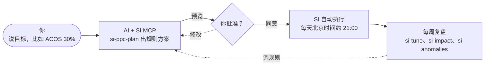

# Scale Insights MCP 能力调查报告

> 原页面标题：Scale Insights MCP 能做什么  
> 通读 SI 帮助中心、博客、MCP 更新日志和技能包后整理：AI 通过 MCP 能读哪些数据、能直接改什么、能不能写自动化规则，有哪些限制，以及目前能找到的真实案例。核对时间：2026 年 11 月 13 日（北京时间）。

## 目录

- 结论
- 概况与接入
- 读取能力
- 写入能力（直接改广告）
- 通过 MCP 写自动化规则
- 技能包与 49 个 si- 指令
- 限制与文档矛盾
- 真实案例
- 放进你的流程
- 试用期要验证的问题
- 来源

## 结论

> **一句话：** SI 的 MCP 让 AI 读你账户里算好的数据，直接改出价、预算、否定词、启停、位置加价等，还能按你的大白话生成自动化规则包，之后由 SI 每天自动执行。所有改动先预览、你批准后才生效。它不能新建活动、广告组或关键词；公开的真实用户案例很少，大多来自 SI 自己的博客。

- 最符合你需求的功能：si-ppc-plan。AI 读产品利润和历史表现，提出出价、收割、否定等规则，你在聊天里改目标（比如“ACOS 控制在 30%”），确认后生成规则包，之后由 SI 执行。
- 直接写入（11 月 9 日更新后）：出价、否定词、日预算（可按条件批量）、SP 关键词和商品投放的启停、位置加价、竞价策略、重命名、产品成本。
- 能不能直接暂停 SP 活动，SI 自己的文档前后矛盾，试用时要实测。
- 规则包一旦应用就不能撤销；其他改动在还能回退时可以撤销。
- 频率限制和单次批量上限，文档都没有说明。

## 概况与接入

| 项目 | 说明 |
|---|---|
| 状态 | 公开测试版（Open Beta），2026 年 6 月 15 日首个 Claude 测试版，8 月 4 日博客宣布公测 |
| 服务器地址 | `https://mcp.scaleinsights.com/mcp`，用 OAuth 2.0 登录你自己的 SI 账户授权 |
| 支持的 AI | 帮助中心写的是 Claude、ChatGPT、Claude Desktop、Cursor / VS Code；接入页只给了 Claude 和 ChatGPT 的步骤。Codex 文档未说明 |
| ChatGPT 条件 | 个人版要开启 Developer mode 再创建自定义 App；没有“Create”按钮说明你的套餐不支持 |
| 门槛 | 没有排队、邀请码或审核；有 SI 账户即可连接 |
| 试用与价格 | 30 天免费试用，功能全开，但自动化只能用于 1 个产品、1 个站点。付费按自动化的 ASIN 数算：5 个 $78/月，10 个 $98，20 个 $178 |
| MCP 是否另收费 | 文档未说明（价格页没有单列 MCP） |
| 多账户 | 合并过的账户用 si-accounts 和 si-account 切换；没合并的账户在 Claude 网页版加多个连接器（网址后加 ?act1、?act2 区分） |
| 权限 | AI 只能看到你这个 SI 用户本来就有权限看的数据；子账号看不到无权限的板块 |

接入步骤：

1. **注册并登录 Scale Insights**：试用不用绑卡
2. **账户菜单 → Set Up MCP Connection**：在 Connect MCP 页选 Claude 或 ChatGPT，按提示添加连接器并点 Allow
3. **安装 LLM Skill（可选）**：下载 scale-insights-mcp-skill.zip，在 Claude 的 Skills 或 ChatGPT 的 Skills 页上传；装了才能用 si- 简写
4. **验证**：问一句“Show my account summary”或输入 si-daily，有数据返回就是连好了

## 读取能力

*读取不需要审批；数据范围受你的 SI 用户权限限制。*

| 数据 | 能读到什么 | 来源 |
|---|---|---|
| 销售与利润 | 销售额、订单、TACOS、退款、利润、盈亏平衡 ACOS（需要设置产品成本） | 接入页、技能包 |
| 活动 / 关键词 / 搜索词 | 表现数据，附带活动和广告组的 ID 与名称；搜索词保留来源关键词或投放 | 9 月 30 日更新 |
| 位置 | 搜索顶部、其余搜索、商品页的表现及最新同步的加价比例 | 9 月 30 日更新 |
| 活动设置 | 预算（每日或总预算）、竞价策略、位置加价，包括已暂停和已归档的活动 | 10 月 15 日更新 |
| 产品成本 | 默认成本，以及按日期区间设置的生产和头程成本（需要利润权限） | 10 月 15 日更新 |
| 库存 | 可售天数、断货日期、AWD 库存、在途、仓库库存 | 11 月 9 日更新 |
| SQP 与排名 | 搜索查询表现、关键词排名（需在 SI 里追踪） | 接入页、新加坡大会回顾 |
| 改动历史 | 过去的出价和预算改动及其前后效果（si-impact） | 接入页 |
| 自动化配置 | 现有规则、分配情况；预览已保存的出价规则会怎么改 | 6 月 20 日更新、规划文章 |

MCP 工具名在公开资料里只出现了一部分：resolve_shortcut、resolve_account、get_executive_brief、get_next_move、get_organic_upside、get_automation_setup、get_automation_playbook、simulate_proposed_bid_rule、build_rule_package、render_ppc_plan、get_ppc_plan_priorities、propose_*、apply_change_set、undo_change_set。完整工具清单要登录连接后才能看到，这次没有看到。

## 写入能力（直接改广告）

*所有写入都是“先生成预览 → 你明确同意 → 再执行”，技能包规定不能在生成预览的同一轮里直接执行。*

| 动作 | 类型 | 作用对象 | 批量还是单条 | 可撤销 | 来源 |
|---|---|---|---|---|---|
| 改出价 | 修改 | 关键词、商品投放 | 可多条一起预览；上限文档未说明 | 可以 | 帮助 FAQ、7 月 19 日更新 |
| 加否定词 | 新建 | 否定关键词（否定投放文档未说明） | si-waste 会给出整批清单 | 可以 | 帮助 FAQ、接入页 |
| 改日预算 | 修改 | 活动日预算 | 按条件批量筛选（ACOS、ROAS、花费、点击、转化率等，可“且”可“或”），可设上限 | 可以 | 10 月 16 日更新 |
| 暂停或重启关键词、商品投放 | 启停 | 仅 SP | 先筛选再勾选要停的 | 可以 | 11 月 9 日更新 |
| 暂停或重启活动 | 启停 | 仅 SP | 文档未说明 | 可以 | 11 月 9 日更新说能，帮助 FAQ 说不能 |
| 改位置加价 | 修改 | 活动的位置加价 | 文档未说明 | 可以 | 11 月 9 日更新 |
| 改竞价策略 | 修改 | 活动 | 文档未说明 | 可以 | 11 月 9 日更新 |
| 重命名 | 修改 | 活动、广告组合 | 文档未说明 | 可以 | 11 月 9 日更新 |
| 改产品成本 | 修改 | 生产和头程成本（可按日期区间） | 单个产品 | 可以 | 11 月 9 日更新 |
| 应用规则包 | 新建规则 | 自动化规则及其分配 | 整包 | 不可撤销 | 11 月 9 日更新 |
| 关键词排名追踪开关 | 启停 | 排名追踪 | 只能在 si-organic 的报告界面里点按钮 | 文档未说明 | 技能包 |

> ⚠️ **MCP 不能直接做的：** 新建活动、广告组、正向关键词或商品投放；启停广告组；删除或归档任何对象。SB 和 SD 能不能写入，文档未说明。不过可以通过规则间接做到一部分：收割规则会把搜索词加成新关键词，状态规则可以暂停活动和广告组，前提是规则生效后由 SI 执行。si-organic 可以带你跳到预填好的单关键词活动创建页，但最后还是在 SI 网页上创建。

## 通过 MCP 写自动化规则

能。这就是“AI 负责写规则，SI 负责执行”的核心。流程是 si-ppc-plan：AI 分析产品利润、盈亏平衡和历史表现，提出规则方案并附上推理依据，你在聊天里改目标，确认后生成规则包。

| SI 的 11 种规则 | 做什么 | MCP 能否生成 | 依据 |
|---|---|---|---|
| 出价 Bidding | 按表现调关键词和投放的出价，或改关键词状态 | 能 | 规划文章、11 月 9 日更新 |
| 收割 Import | 把出单的搜索词加成关键词或商品投放 | 能 | 规划文章、11 月 9 日更新 |
| 否定 Negative | 把表现差的搜索词加为否定 | 能 | 规划文章、11 月 9 日更新 |
| 状态 Status | 按表现或库存暂停、启用活动和广告组 | 能（“基于库存启停”） | 11 月 9 日更新 |
| 日预算 Daily Budget | 按表现或星期几调整日预算 | 能 | 11 月 9 日更新 |
| 位置 Placement | 调搜索顶部、其余搜索、商品页加价 | 能 | 11 月 9 日更新 |
| 分时 Dayparting | 按小时调出价或启停广告组 | 能 | 11 月 9 日更新 |
| 否定词根 Negative Word | 把常出现在差搜索词里的单词设为否定词组 | 文档未说明 | 无 |
| 黑名单 / 白名单 | 固定屏蔽某些词，或保护重要词不被否定 | 文档未说明 | 无 |
| 复活 Revive | 给曾经出单但没流量的词逐步加价 | 文档未说明 | 无 |
| 默认出价 Default Bid | 调旧版自动广告的默认出价 | 文档未说明 | 无 |

- 应用方式有两种。11 月 9 日更新说确认账户和站点后可以直接在聊天里应用；11 月 13 日的帮助文章仍写着要下载 BulkRuleEditor ZIP，再到网页的 Bulk Rule Editor 上传。两种说法不一致。
- 规则执行时间：每天约 UTC 13:00（北京时间 21:00）跑一次；分时规则每小时跑；日预算规则在站点时区每天开始时跑。
- 规则内的条件之间是“且”的关系，可设优先级和上下限（比如最高出价）；出价规则有策略模拟器，可以先看效果。
- 11 月 9 日起，PPC 规划会预览一周内的出价变化、要收割的词、会被暂停的广告组、位置和预算变化，并提醒已有规则可能先执行。
- 其他配套指令：si-automate 找没规则的高花费广告组；si-tune 评估规则效果；si-bidding-rules 预览已保存规则会怎么改出价。
- 规则包不能撤销。网页上的 Bulk Manage（11 月 5 日 Beta）可以下载整套自动化配置作备份，回滚靠它。

## 技能包与 49 个 si- 指令

*接入页和技能包都写 49 个（8 类），帮助中心写 46 个，以接入页为准。不装技能包也可以直接用中文或英文描述需求。*

### 战略分析（13 个）

| 指令 | 作用 |
|---|---|
| `si-analyst` | 全账户周报：钱在哪赚、在哪亏、哪里漏了，按美元从大到小排出本周动作 |
| `si-nextmove <asin>` | 单个产品完整报告：对比它最好的时期、过去调价和加花费的效果、下一步动作 |
| `si-organic [asin,…]` | 自然排名机会：哪些搜索词你有希望排上去、值多少利润、哪些该放弃 |
| `si-diagnose` | 每个产品处在什么阶段（冲排名、收割、边际递减……）及该做什么 |
| `si-why <指标>` | 解释销售额、ACOS、TACOS、CPC 或利润的变化由哪些因素造成 |
| `si-patterns [asin]` | 哪些指标经常一起变动（只是待验证的规律，不是因果） |
| `si-tune` | 每条自动化规则启用前后的效果对比，哪些规则值得推广到别的广告组 |
| `si-automate` | 找出花费高但没有有效规则的广告组，给出建议规则和参数 |
| `si-ppc-plan [asin]` | 产品优先级；带 ASIN 时生成该产品的规则方案，聊天里改，最后出规则包 |
| `si-sqp [asin]` | SQP 周度搜索可见度、漏斗流失点、精准词覆盖与 TACOS |
| `si-anomalies` | 早间巡检：花费暴涨、ACOS 超标、零单烧钱、预算封顶 |
| `si-impact [date]` | 你的调价、调预算改动是否有效，逐条对比前后 |
| `si-savings` | Scale Insights 自动化帮你省了多少钱和时间 |

### 快速开始（5 个）

| 指令 | 作用 |
|---|---|
| `si-help` | 显示全部快捷指令菜单 |
| `si-accounts` | 列出你能访问的 SI 账户及当前选中的账户 |
| `si-account <账户名>` | 切换到另一个账户（本次对话内有效） |
| `si-health-check` | 账户健康快照：花费、ACOS、ROAS、放量机会、浪费 |
| `si-daily` | 昨天的花费、广告销售额、订单、ACOS、ROAS |

### 广告效率（12 个）

| 指令 | 作用 |
|---|---|
| `si-waste` | 找出关键词、搜索词、投放上的浪费花费，最后给出可审批的改动清单 |
| `si-negatives [asin]` | 从不出单的搜索词生成否定词清单 |
| `si-bids [asin]` | 哪些出价该升、哪些该降 |
| `si-placements` | 搜索顶部、商品页、其余位置的表现与加价比例 |
| `si-weak-campaigns` | 表现差的活动及可能原因 |
| `si-pacing` | 预算提前花光的活动及错过的需求 |
| `si-adtype-mix` | SP、SB、SD 效率对比，预算该往哪挪 |
| `si-match-types [asin]` | 广泛、词组、精准的效率对比 |
| `si-branded <品牌>` | 品牌词与非品牌词花费拆分 |
| `si-conquest [asin]` | 竞品 ASIN 和类目投放：该放大还是砍掉 |
| `si-breakeven [asin]` | 每个产品的盈亏平衡 ACOS，以及哪些活动超了 |
| `si-bidding-rules [asin]` | 预览已保存的出价规则会改哪些出价，规则是否已分配 |

### 利润与转化（5 个）

| 指令 | 作用 |
|---|---|
| `si-profit-leaks` | 利润漏在哪：广告浪费、退款、薄利 |
| `si-returns [asin]` | 退款率审计及其利润损失 |
| `si-cvr [asin]` | 诊断低转化：是 listing 和价格问题，还是流量问题 |
| `si-traffic [asin]` | 会话流量趋势及早期下滑预警 |
| `si-pricing <asin>` | 调价对销量和转化的影响 |

### 增长（3 个）

| 指令 | 作用 |
|---|---|
| `si-scale-ads <asins>` | 先查库存，再判断能不能安全放量 |
| `si-budget [金额]` | 预测加预算的效果，在活动间分配，砍弱补强 |
| `si-growth` | 增长空间最大的 ASIN 及该拉哪个杠杆 |

### 关键词（3 个）

| 指令 | 作用 |
|---|---|
| `si-keywords [asin]` | 最好的自然词和广告词、机会词、低点击率浪费曝光 |
| `si-harvest [asin]` | 已出单但还没有精准词的搜索词 |
| `si-defend-rank [asin]` | 保护排名靠前的高价值词，以及正在掉排名的词 |

### Listing（3 个）

| 指令 | 作用 |
|---|---|
| `si-rewrite-listing [asin]` | 抓取转化最好的搜索词，重写标题、五点和后台词 |
| `si-listing-impact <date>` | 改 listing 前后的转化和退货对比 |
| `si-launch-check <asin>` | 新品诊断：排名、转化、广告经济性、库存 |

### 库存与站点（5 个）

| 指令 | 作用 |
|---|---|
| `si-inventory [asins]` | 每个 ASIN 的可售天数和断货风险 |
| `si-restock` | 补货优先级清单 |
| `si-seasonality` | 季节性高峰，以及库存是否跟得上 |
| `si-recover` | 收入下降原因及恢复计划 |
| `si-compare-markets <站点>` | 多站点并排对比 |

技能包从 8 月 1 日起会自动更新：报告格式和指令说明由服务器下发，不用重新下载。技能包规定 AI 要分开写“数据事实”和“建议”，标明站点、日期范围和范围；改动 2 周内不评判效果，因为亚马逊归因有约两周的延迟。

## 限制与文档矛盾

| 问题 | 文档怎么说 |
|---|---|
| 调用频率、单次改动条数上限 | 文档未说明 |
| 写入是否要先开启 | 接入页写“写入默认关闭”，但没说在哪开启 |
| SB / SD 写入 | 文档未说明；暂停功能明确只写了 SP |
| SD 搜索词 | 亚马逊不提供 SD 搜索词，相关分析只覆盖 SP |
| 规则包撤销 | 不可撤销 |
| 其他改动撤销 | “在还能撤回时”可以撤销，时限文档未说明 |
| 试用期限制对 MCP 的影响 | 试用期自动化只能管 1 个产品；MCP 生成的规则是否也受此限制，文档未说明 |
| 空选择与冲突 | 批量改预算时，空的活动选择会被拒绝；上下限冲突的活动会被跳过 |

### 文档矛盾

| 矛盾 | 说法 A | 说法 B |
|---|---|---|
| 能否暂停 SP 活动 | 11 月 9 日更新：可以暂停或重启 SP 活动 | 帮助 FAQ（11 月 12 日更新）：不支持暂停或启用活动 |
| 规则包怎么生效 | 11 月 9 日更新：可以直接在聊天里应用 | 规划文章（11 月 13 日）：必须下载 ZIP 再到网页上传 |
| 指令数量 | 接入页、技能包：49 个 | 帮助中心：46 个 |
| 能不能改账户 | 公测博客（8 月 4 日）：只读，“不会动你的账户” | 同一篇及后续更新：批准后可改出价、预算、否定词等 |
| 支持的客户端 | 帮助中心：Claude、ChatGPT、Claude Desktop、Cursor / VS Code | 接入页：只有 Claude 和 ChatGPT 的步骤 |

## 真实案例

*公开案例不多；带具体数字的几乎都来自 SI 自己的博客，没有第三方验证。*

### 案例 1：Kevan Soh（Everloop，八位数美元年销售额、多品牌卖家）

用 Claude 加 SI MCP 跑三项固定任务：找可赢的需求、把胜过市场的词拆成独立活动、每周清理无效花费。AI 只读和提建议，他逐行审批；写回亚马逊（包括建活动）用的是他自己的方案，不是 SI MCP。3 个产品上自然收入每天分别 +130%、+84%、从 0 到占销售额三分之一；其中一个转化率 12% → 17.7%，广告成本占比 20.5% → 7.3%，日花费 $27 → $13。还发现 230 个否定词（205 个是单词）挡住了自己的好词，以及一个 ACOS 15.3%（盈亏平衡 25.3%）的精准词被暂停了。

*来源：SI 博客 8 月 28 日、新加坡大会回顾*

### 案例 2：未具名的内测用户：AI 写规则，推进 SI 后自动执行

创始人博客原话：这位用户用大白话告诉 Claude 想要什么自动化，Claude 把它写成真规则、推进 SI 并运行，他只决定产品和目标数字。同文还提到：有老用户在“很干净”的账户里找出几万美元的漏洞，有人用 Claude 做了自己的看板。没有姓名和数据。

*来源：创始人博客*

### 案例 3：Trainadz 代运营（Sharel Shamis）

做了一个 Claude 技能，同时调用 SI MCP（广告数据）和 Data Dive（排名和词库），出关键词研究和收割报告：前 20 个词的搜索量同比、自身转化与市场对比、是否已有精准词、可收割的词。他说“收割流程已完全自动化”。这是代运营公司自己的说法。

*来源：YouTube 9 月 15 日、LinkedIn*

### 案例 4：Evan Swanson（X，管理年销 6,000 万美元的品牌）

在 Claude Code 里连 SoldScope、SellerSprite、ScaleInsights 等多个 MCP，用 SI 管 PPC，让 Claude 给出位置加价和出价建议。他同时说 SI 以后可能被亚马逊官方 MCP 取代。有人问他是让 Claude 直接改出价还是逐条审批，没有找到公开回复。

*来源：X 11 月 9 日、11 月 13 日*

### 数据：SI 公布的使用情况

约七分之一的活跃账户贡献了约三分之二的用量；这些人大多隔天就回来用，每次约 14 次调用、4 个工具；最常看的是销售数据（超过三分之一），其次是库存、搜索词和关键词。超过八成的人至少跑过一次 si-analyst。

*来源：SI 博客*

> 这个账户之前用 AdLabs 管，规则只看 ACOS，不看排名和销量，出价一直降到没有曝光，广告销售和排名都丢了。
>
> —— Reddit r/AmazonFBATips 用户，2026 年 7 月（不是专门谈 MCP）

没找到的：Reddit 上专门讨论 SI MCP 的帖子；SI 策略系列里的 MCP 案例（没有逐集查看）；SI Facebook 群 8 月征集 MCP 用例的帖子回复（要登录才能看到）。另外，公开资料里没有一个案例给出“AI 写规则 → SI 执行”这条完整链路的前后数据。

## 放进你的流程

*对应你说的分工：AI 理解你的意图并写成规则，SI 执行，你只负责批准。*

- 你的 138 个活动都是 SP，SI 对 SP 的规则覆盖最全（11 种规则都能用在 SP 上）。
- 这样做之后不用每周再导 CSV、做 Bulk Sheet，日常调整由规则执行；临时改动（比如某个词马上否定）通过 MCP 预览后批准。
- 规则包不能撤销，第一次应用前先在 Bulk Manage 下载整套配置备份。
- 按 SI 的说明，改动后两周内不要评判效果。
- 要托管几个 ASIN 决定价格：主推 ASIN 不超过 5 个就是 $78/月。

## 试用期要验证的问题

1. 写入在哪里开启？接入页说“默认关闭”。
2. 能不能真的通过 MCP 暂停 SP 活动（两份文档说法相反）？
3. 规则包能不能在聊天里直接应用，还是只能下载 ZIP 上传？
4. MCP 能不能生成否定词根、黑白名单、复活、默认出价这 4 种规则？
5. 试用期“1 个产品”的限制下，规则包能否应用到多个 ASIN？
6. 一次改动预览最多能放多少条？有没有调用频率限制？
7. 能不能撤销、能撤销多久？规则包应用后怎么回滚？
8. 用 Codex 或 Cursor 连接是否正常（官方只给了 Claude 和 ChatGPT 的步骤）？
9. 收割规则能不能指定加到哪个广告组，并设每组关键词上限（11 月 5 日已有 1–1,000 的上限设置）？

## 来源

- [Getting Started with Scale Insights MCP](https://help.scaleinsights.com/en/knowledge-base/scale-insights-mcp)，SI 帮助中心，2026-11-12
- [How to Build an AI-Powered PPC Plan Using SI MCP](https://help.scaleinsights.com/en/knowledge-base/-how-to-build-an-ai-powered-ppc-plan-using-si-mcp)，SI 帮助中心，2026-11-13
- [How to Use the SI MCP with Multiple Accounts](https://help.scaleinsights.com/en/knowledge-base/how-to-use-the-si-mcp-with-multiple-scale-insights-accounts)，SI 帮助中心，2026-11-11
- [MCP 接入页、技能下载与更新日志（What's new）](https://portal.scaleinsights.com/Settings/McpConnect)，SI Portal
- [Release Notes, September 07, 2026](https://help.scaleinsights.com/en/knowledge-base/release-notes.-se-2026-)，SI 帮助中心
- [Release Notes, November 05, 2026（Bulk Manage）](https://help.scaleinsights.com/en/knowledge-base/release-notes.-november-05-2026)，SI 帮助中心
- [How to Create and Customize Automation Rules](https://help.scaleinsights.com/en/knowledge-base/how-to-create-and-customize-automation-rules)，SI 帮助中心
- [Overview of Each Automation Algorithm](https://help.scaleinsights.com/en/knowledge-base/overview-of-each-automation-algorithm)，SI 帮助中心
- [Available Algorithms for Ads](https://help.scaleinsights.com/en/knowledge-base/available-algorithms-for-ads)，SI 帮助中心
- [How to Use Bulk Manage for Automation Settings](https://help.scaleinsights.com/en/knowledge-base/how-to-use-bulk-manage-for-automation-settings)，SI 帮助中心
- [Introducing the Scale Insights MCP (Open Beta)](https://blog.scaleinsights.com/introducing-scale-insights-mcp)，SI 博客，2026-08-04
- [Why I Decided to Build SI MCP](https://blog.scaleinsights.com/why-i-decided-to-build-si-mcp)，SI 博客
- [MCP hard questions](https://blog.scaleinsights.com/mcp-hard-questions-amazon-account)，SI 博客
- [How our busiest sellers use the MCP](https://blog.scaleinsights.com/how-our-busiest-sellers-use-the-mcp)，SI 博客
- [When did you become the AI's assistant?](https://blog.scaleinsights.com/when-did-you-become-the-ais-assistant)，SI 博客
- [Kevan Soh 案例](https://blog.scaleinsights.com/ai-agent-amazon-ppc-blueprint)，SI 博客，2026-08-28
- [AI Scaling Live Singapore 回顾](https://blog.scaleinsights.com/ai-scaling-live-singapore-recap)，SI 博客
- [Trainadz 关键词收割技能](https://aiagentsforsellers.com/use-case/keyword-research-and-harvesting-report-skill-with-claude-scale-insights-and-data-dive/)，AI Agents for Sellers
- [Trainadz 视频](https://www.youtube.com/watch?v=PC0OVdBObhM)，YouTube，2026-09-15
- [Evan Swanson 的 MCP 配置](https://x.com/Evan_Swanson_/status/2119912142300500245)，X，2026-11-09
- [Evan Swanson：Claude Code + SI 管广告](https://x.com/Evan_Swanson_/status/2121230350433341616)，X，2026-11-13
- [PPC 软件推荐讨论](https://www.reddit.com/r/AmazonFBATips/comments/1v5ejit/what_amazon_ppc_software_do_you_actually_recommend/)，Reddit
- [Scale Insights 价格页](https://scaleinsights.com/pricing)，scaleinsights.com

---

原始页面：https://scale-insights-mcp-7v6t.pages.grok.bot/
